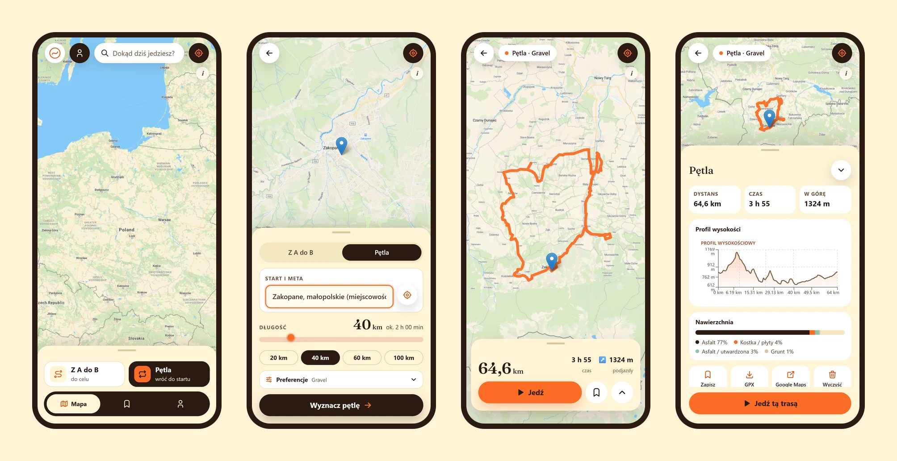
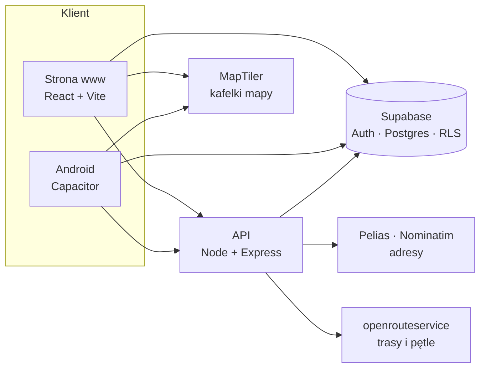

<p align="center">
  
</p>

# Cycle Your Way

Planer tras rowerowych z nawigacją. Wybierasz start i dystans, dostajesz pętlę dopasowaną do swojego roweru — albo trasę z punktu A do B — a potem jedziesz z głosowymi wskazówkami, zakręt po zakręcie.

**[cycleyourway.pl](https://www.cycleyourway.pl)** · aplikacja na Androida w przygotowaniu do Google Play · [polityka prywatności](https://www.cycleyourway.pl/privacy)

<p align="center">
  
  <br>
  <sub>Start · planowanie pętli · wynik · szczegóły trasy</sub>
</p>

## Co potrafi

**Planowanie**
- Pętle od 5 do 200 km z dowolnego miejsca i trasy A → B z maksymalnie pięcioma punktami pośrednimi; kilka wariantów do porównania.
- Pięć stylów jazdy — szosa, gravel, MTB, miasto, trekking — oraz unikanie głównych dróg, preferencja asfaltu i podjazdów.
- Profil wysokości, nawierzchnia i stromizny widoczne przed wyjazdem.

**W trasie**
- Nawigacja głosowa po polsku, mapa podążająca za rowerzystą, wykrywanie zjechania z trasy i przeliczenie drogi powrotu.
- Najbliższy odcinek wyróżniony strzałkami kierunku, reszta trasy przygaszona; strzałka pozycji obraca się z kompasem.
- Przebieg jazdy zapisuje się na urządzeniu na bieżąco, więc nie ginie bez zasięgu ani po zamknięciu aplikacji.

**Konto**
- Zapisane trasy z tagami i ulubionymi, udostępnianie linkiem, eksport do GPX.
- Historia jazd i statystyki, eksport wszystkich danych i usunięcie konta z poziomu aplikacji.

<p align="center">
  
  <br>
  <sub>Sekcja „Jak to działa” na stronie — krajobraz przesuwa się warstwami podczas przewijania, a rowerzysta jedzie przez scenę.</sub>
</p>

## Jak to jest zbudowane



- **Jedna aplikacja, dwa miejsca.** Android to ten sam kod React opakowany w Capacitor, z natywnym GPS, logowaniem Google przez systemową przeglądarkę i obsługą przycisku wstecz. Na telefonie w przeglądarce strona przełącza się na ten sam układ co aplikacja.
- **Klucze dostawców zostają na serwerze.** Wszystkie zapytania o trasy i adresy idą przez API, które pilnuje limitów — na minutę i na dobę, osobno dla gości i zalogowanych — za pomocą wspólnego licznika w Supabase oraz dziennego budżetu zapytań do dostawcy.
- **Dane użytkownika za RLS.** Tabele z trasami, jazdami i profilami chronią polityki wierszy, a udostępnianie tras działa przez nieodgadywalne tokeny; polityki i funkcje mają własne testy SQL.

| Warstwa | Technologie |
| --- | --- |
| Interfejs | React 19, Vite, Tailwind CSS, Leaflet, Motion, Recharts |
| Aplikacja mobilna | Capacitor 8 (Android) |
| API | Node.js 22, Express |
| Konta i dane | Supabase — Auth, Postgres, Row Level Security |
| Mapy i trasy | MapTiler, OpenStreetMap, openrouteservice |
| Hosting | Vercel (strona), Render (API) |

## Struktura repozytorium

```
.
├── .github/workflows/ci.yml   lint, typy, testy i build przy każdym PR
└── cycle-route-mvp/
    ├── frontend/              strona i aplikacja (React; android/ to projekt Capacitor)
    ├── backend/               API: trasy, pętle, adresy, limity
    ├── supabase/              schema.sql, migracje, testy RLS
    └── docs/                  wdrożenie, operacje, postęp prac, dokumenty prawne
```

## Uruchomienie lokalne

Potrzebne: Node.js 22, klucz [openrouteservice](https://openrouteservice.org/dev/#/signup) i projekt [Supabase](https://supabase.com).

**1. Baza.** W SQL Editorze Supabase uruchom `cycle-route-mvp/supabase/schema.sql`, a potem pliki z `supabase/migrations` w kolejności dat.

**2. API**

```bash
cd cycle-route-mvp/backend
cp .env.example .env        # ORS_API_KEY, ALLOWED_ORIGINS
npm install
npm run dev                 # http://localhost:5000
```

**3. Strona**

```bash
cd cycle-route-mvp/frontend
cp .env.example .env.local  # VITE_SUPABASE_URL, VITE_SUPABASE_ANON_KEY, VITE_API_URL
npm install
npm run dev                 # http://localhost:5173
```

**4. Android** (opcjonalnie; wymaga Android Studio i JDK 21)

```bash
cd cycle-route-mvp/frontend
npm run cap:sync            # build w trybie android + synchronizacja z projektem natywnym
npm run cap:open            # otwiera projekt w Android Studio
```

## Testy

```bash
cd cycle-route-mvp/frontend && npm run lint && npm run typecheck && npm test && npm run build
cd cycle-route-mvp/backend && npm test
```

Testy polityk RLS i funkcji bazy opisuje [`supabase/tests/README.md`](cycle-route-mvp/supabase/tests/README.md). Te same kroki uruchamia CI przy każdym pull requeście.

## Dokumentacja

| Plik | O czym |
| --- | --- |
| [`IMPLEMENTATION_PROGRESS.md`](cycle-route-mvp/docs/IMPLEMENTATION_PROGRESS.md) | Co zostało zrobione, pakiet po pakiecie, razem z wynikami weryfikacji |
| [`DEPLOY_BACKEND.md`](cycle-route-mvp/docs/DEPLOY_BACKEND.md) · [`SUPABASE_VERCEL.md`](cycle-route-mvp/docs/SUPABASE_VERCEL.md) | Wdrożenie API, bazy i strony |
| [`OPS_LAUNCH.md`](cycle-route-mvp/docs/OPS_LAUNCH.md) · [`LAUNCH_CHECKLIST.md`](cycle-route-mvp/docs/LAUNCH_CHECKLIST.md) | Monitoring, limity i lista przed startem |
| [`MOBILE.md`](cycle-route-mvp/docs/MOBILE.md) | Aplikacja Android: budowanie, logowanie, testy na urządzeniu |

## Dane mapy i licencje

Mapa © [OpenStreetMap](https://www.openstreetmap.org/copyright) contributors, kafelki © [MapTiler](https://www.maptiler.com/copyright/), trasy © [openrouteservice.org](https://openrouteservice.org/) by HeiGIT. Fonty Fraunces, Source Sans 3 i Anton są na licencji SIL Open Font License.

Kod nie jest objęty licencją open source — wszelkie prawa zastrzeżone.
